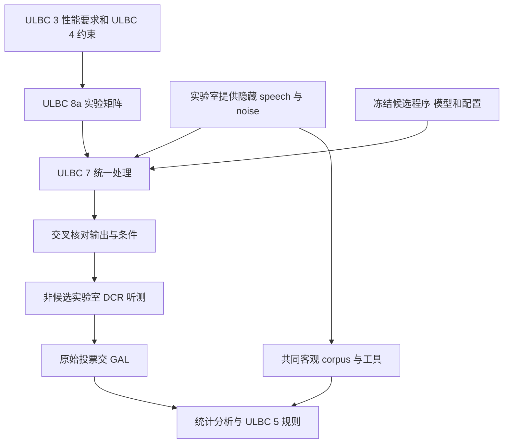

# 测试与处理流程分析

> 对应原 Overview Step 7，覆盖 R4 4.7/4.8。主干为 167 / ULBC-8a v0.1.0 和 181 / ULBC-7 v0.2.0；对照 166、177、171、145、114、103，以及材料分离的 183。

## 1. 本主题的结论

选择测试已采用 P.800 DCR、非候选实验室，并要求所有候选在同一测试中比较；但 **167 的具体实验矩阵与 181 的处理链尚未形成可直接运行的完整规范**。181 大量继承 EVS 模板，必须按当前 ULBC 参数清理，不能照抄其命令行。

测试计划回答“测什么、谁测、如何评价”；处理计划回答“怎样生成完全可重复的测试音频”。两者还必须与 ULBC-3 门槛、ULBC-4 约束和 ULBC-5 选拔规则一致。

## 2. 来源与版本

| 来源 | R4 状态 | 当前用途 |
|---|---|---|
| [167：ULBC-8a](sources/S4aA260167_source.md) | a，157→167 | Selection 测试主体，替换早期 Qualification 表述 |
| [181：ULBC-7](sources/S4aA260181_source.md) | a，128→181 | 处理框架；正文大量括号/继承内容 |
| [166：experiment design](sources/S4aA260166_source.md) | a，125→166 | 全候选比较、运行点拆分、实验室方法 |
| [177：objective database](sources/S4aA260177_source.md) | a，119→177 | 共同客观 corpus 的 baseline |
| [171：noise collection](sources/S4aA260171_source.md) | a，146→171，151 m→171 | speech/noise 供应职责 |
| [145](sources/S4aA260145_source.md)、[114](sources/S4aA260114_source.md)、[103](sources/S4aA260103_source.md) | n | 资格阶段分布设计、非平稳噪声与语言覆盖提案 |

167 的版本记录明确从 Qualification 改为 Selection。这与 Step 1 的直接 selection 工作假设相符；145 的 qualification 方案保留为备选讨论，不恢复成必经阶段。

## 3. 先建立实验和处理的连接

下图是本分析根据文档职责整理的概念流程；节点中的未定配置需先冻结后才能执行。

这是处理关系图，不意味着 167 已任命所有实体或 181 已提供所有可执行工具。

## 4. 167 中已写出的测试方法

### 4.1 DCR 与重复测试

[167 方法段](sources/S4aA260167_source.md#P082)采用 P.800 DCR。每个 trial 先听 reference，再听同一材料经系统处理的版本，按 5 到 1 分评估劣化：不可闻到非常恼人。

它写明每个 speech experiment 在两个 LL、两种语言重复，并用被测语言母语听者；每个 panel 测试时长不应超过 2 小时。[实验组织段](sources/S4aA260167_source.md#P119)要求所有候选在同一测试，并在候选数 ≥ X 时每运行点单独测试，X 可能为 13，但 TBC。

不能把 X=13 当作已定分界，也不能把“每个实验两种语言”理解成所有 codec 一定只测两种语言；总语言数取决于整个实验分配。

### 4.2 材料长度与语言清单

[材料段](sources/S4aA260167_source.md#P105)规定 speech sample 正好 8 秒，句间和首尾各至少 0.5 秒“silence”，这里 silence 是录音背景噪声而非全零数据。

初步 requested languages 包括 UK/US English、Mandarin、Spanish、French、Hindi、Arabic；German、Slavic language、Japanese、Danish、Swedish 带括号。具体 LL/语言/实验分配表仍空白，不能视为合同或全覆盖承诺。

103 主张先按服务人口、市场与语音类型确定语言，再选实验室；170 讨论声学/语音类型代表性，173 强调预算和能力限制。它们提供规划方向，不给出一个已经闭合的 X/Y 语言数量。

## 5. 实验室角色与交付

| 角色 | 主干已给出的方向 | 未完成内容 |
|---|---|---|
| PC | 向 HL/CL 提交 ULBC executables | 完整候选运行包和平台与 ULBC-6 对齐 |
| LL | 准备材料、听测、将原始投票直接交 GAL，向 SA4 报告 | 具体任命、语言与详细操作条款 |
| HL | 测试接收与统一协调实体 | 多处职责标题没有完整正文 |
| CL | 交叉核对实体 | 核对范围、验收方法 |
| GAL | 原始数据汇总及全局分析 | 统计实现、完整计划和任命 |
| SA4 | 选择 LL、语言、HL/CL/GAL，按时间线决策 | 多项合同/分配事项未冻结 |

来源：[167 roles](sources/S4aA260167_source.md#P049)。[171](sources/S4aA260171_source.md#P016)另明确 Noise Laboratory 供应噪声；可分多供应者，LL 也可担当。

167 的职责分工并不完整。181 的 Responsibilities 直接要求澄清 host/processing/listening labs；不能凭常见行业分工填成文件已经规定的任务。

报价 [18000] Euro/LL DCR test、[1000] Euro/talker 新录音、[14000] Euro/GAL 均带括号，不能当作预算已获批。金额用于描述原文的采购假设，不构成当前市场报价。

## 6. 166 的实验设计与采纳范围

166 的论证采用 pair-balanced 设计示例：25 个 point-relevant conditions、30 个 source items，每听者每条件 6 个 source items，每个条件对恰有一个共享 source item；25 个 playlist rotations，每位听者 180 trials，共 4500 trials。

这些是文件的验证设计实例，不是 167 已冻结的 candidate 数、talker 数和听者数。原文 Proposal 2 的条件是候选数 ≥ X 才拆运行点，并明确 X 可能 13/TBC；不能把前文“每运行点总是拆开”的论证代替最终措辞。

167 已纳入全候选同测、条件式运行点拆分及非候选实验室 DCR。其通用 randomization/panel 部分和 presentation-order 附录仍含旧模板，与 pair-balanced 方案需协调；后者不能只靠一个状态 a 推断完整写入。

166 文字声称提供 `rand_DCR_P800_pairbalanced_L25.csv` 附件，但本地 ZIP 仅有 DOCX 和 macOS 元数据，DOCX 也没有嵌入附件。因此本轮不能验证 CSV 的 300 个条件对或随机化性质；已核对文字中的 25×180=4500。缺附件属于本地可核验范围限制，不等于作者的设计结论错误。

145 则提出 20 proponents/labs、60 qualification tests、每候选 18 labs、禁止自测及语言分层等备选方案。当前直接 selection 与非候选 LL 路线不同，不能把它的 20/18/60 参数复制进 167。

## 7. 181 的通用处理链怎样理解

[181 P012](sources/S4aA260181_source.md#P012)明确大部分内容来自 EVS-7c，全部需要进一步 review；正文从 P008 的 `[` 到 P668 的 `]` 保留整体括号。

以下是可用于理解的处理框架，不是已经验证运行成功的脚本：

| 阶段 | 181 文字提供的操作 | 需要核实的重点 |
|---|---|---|
| 接收原始材料 | 48 kHz、16-bit WAV；命名区分 lab/experiment/talker/sample | 文件格式、来源和分离承诺 |
| 滤波与转换 | HP50/MSIN、48→16/32 kHz 等工具链 | WB/SWB 频带、滤波版本及延迟 |
| 电平与混噪 | P.56 speech level；RMS noise；noise scaling 后叠加 | SNR 计量频带、offset、clipping |
| 拼接与初始化 | 10 秒低幅随机噪声 preamble、句子串接 | 状态暖机、拼接表是否采用 |
| codec/信道处理 | encoder→bitstream→erasure 或 network simulator→decoder | 对齐到同一媒体时间和 bundle |
| 输出切分 | segmentation、100 ms 窗、上采样用于播放 | JBM trace 对切分位置的影响 |
| 客观测量 | AFR、active/inactive gain | 方法正文仍为省略号 |

### 7.1 SNR 公式不能脱离计量滤波

[181 噪声 scaling](sources/S4aA260181_source.md#P152)写 `F = -(R + S + 26)`，R 是指定滤波/采样条件下的 noise RMS dBov，S 是目标 SNR。它以 -26 dBov speech 基准建立，不是对任意未经处理 speech/noise 直接适用的万能公式。

[电平表](sources/S4aA260181_source.md#T336)对 -16/-36 dBov 给出 ±10 dB scaling/descaling。仍需核实混噪、变电平和输出调整的顺序，避免把不同定义的 SNR 混为一谈。本文未执行音频处理或测量。

### 7.2 丢包必须落在相同媒体区间

[181 P115–118](sources/S4aA260181_source.md#P115)要求候选与参考的 erasures 影响相同 speech segments，并处理 encoder delay；同时承认 exact compensation 可能不可行，需要适配不同 frame/bundle。

不能直接复用 20 ms error pattern 而不映射到 80/160 ms ULBC bundle。时间对齐、丢失事件跨度与累计 FER 都应明确，DTX NO_DATA 也不应被错误计成网络损失。

JBM 引入时变播放延迟，181 留有 network simulator 与 decoder trace、jbmtrim 流程。是否采用现有 MTSI profiles，以及如何产生 NB-IoT 到达瞬态，须与 Step 3D 和传输系统依赖对齐。

### 7.3 非平稳噪声不能只挑随机起点

[114](sources/S4aA260114_source.md#P015)提议实际评价段应包含 intended scene 的事件，如车辆驶过，并在候选和参考中使用同一段。随机抽到的 street 文件片段可能缺少交通事件；只保证整段原录音“是 street”不足以证明所测条件有代表性。

该建议为 n 状态；181 仍有噪声类型 TBD 和随机 offset 模板，未见完整纳入事件验收。需把随机性和事件覆盖一起定义。

## 8. 当前模板残留与冲突清单

| 位置 | 文字问题 | 正确处理 |
|---|---|---|
| [181 P513–529](sources/S4aA260181_source.md#P513) | “ULBC”示例列 5900、7200、13200 等至 128000 bit/s，含 AMR-WB IO 和 switching | EVS 继承残留，不能作为 1.0/1.4 kbit/s ULBC 命令规范 |
| [181 P612–623](sources/S4aA260181_source.md#P612) | ULBC rate switching profiles | 与 184 会话固定码率/周期方向不一致，需删除或重写 |
| 181 NB/FB、mixed/music、channel-aware 部分 | 许多 if applicable/旧模式 | 依最终测试范围裁剪，不自行增加强制能力 |
| [181 P563](sources/S4aA260181_source.md#P563) 与 P027 | [Win32] 要求，但 platform TBD | 平台未冻结 |
| [167 P193](sources/S4aA260167_source.md#P193) | 仍写 stereo speech/music/mixed content 表题 | 与 ULBC mono 基线不一致，属于模板需清理项 |
| 167 附录 timeline、conditions、labs | 大量空表及 X/Y/Z/W | 不存在完整可执行矩阵 |
| 167/181 与 183 | 分离条文未全部整合 | 后续版本需确认 |

181 拼接模板为 6 talkers×5 samples×8 秒+10 秒=250 秒，AMR-WB noisy DTX 还给 500 秒重复流程；166 例子为 5 类 talker×6 items=30 source items。总样本数相同不意味着分配设计相同，不能拼接成一个未说明的新实验方案。

## 9. 客观流程的落实程度

[181 objective corpus](sources/S4aA260181_source.md#P648)已经写入 clean/noisy speech、P.501 baseline、noise TBD；[177 最终段](sources/S4aA260177_source.md#P053)指定 P.501 (04/25) Annex C。

但是 AFR 和 gain measuring 仍只有标题与省略号；不能宣称已经实现了 Step 2 的 pass/fail 或 Step 3F 的能量检查工具。已选 speech baseline 不等于完整数据库、处理链、频带和统计法都冻结。

## 10. 建议冻结的执行记录

每个实验至少记录 source lineage/hash、候选及模型版本、运行点、滤波与 P.56/RMS 方法、噪声段及 SNR、loss/JBM profile、随机化脚本与 seed、输出 hash、cross-check、原始 voting 和 GAL 统计版本。这是分析建议，尚不是填完的官方模板。

建议建立要求→实验→条件→source/工具→统计判据的映射。当前缺失项包括：完整实验条件、实验室任命、听者/panel 参数、噪声 corpus、183 整合、ULBC executable 接口、frame/bundle 损失映射、AFR/gain 工具以及统计决策规则。

[数据集与分离](Topic06_datasets_and_separation.md)、[资格与选拔规则](Topic08_qualification_and_selection.md)、[传输与系统集成](Topic09_transport_and_system_integration.md)、[总体 Overview](../Audio_SWG_Tdoc_allocation_R4_overview.md)。
